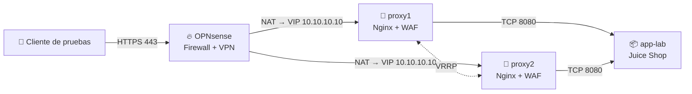

# 🛡️ Capa de Publicación Segura y de Alta Disponibilidad

**Laboratorio de seguridad web con WAF redundante, segmentación y VPN con MFA**

Curso **Seguridad de TI** · Universidad Privada de Tacna · Ingeniería de Sistemas · 2026-II
Docente: Dr. Renzo Alberto Taco Coayla

---

## 📌 ¿De qué trata?

Un laboratorio de **4 máquinas virtuales** que demuestra cómo proteger una aplicación web con:

- 🔥 **OPNsense**: firewall, segmentación de redes y VPN con MFA
- 🧱 **WAF redundante**: Nginx + ModSecurity v3 + OWASP CRS en dos proxies
- 🔁 **Alta disponibilidad** de la capa proxy con keepalived (IP virtual compartida)
- 💾 **Recuperación** de configuraciones con copias cifradas

> La "Universidad X" es solo contexto hipotético. El prototipo usa una aplicación de laboratorio con datos sintéticos.

## 🏗️ Arquitectura

Solo un proxy atiende la VIP a la vez; ambos mantienen el WAF activo.

### 🖥️ Máquinas virtuales

| VM | vCPU | RAM | Disco | Función |
| :-- | :-: | :-: | :-: | :-- |
| `firewall` | 2 | 4 GB | 20 GB | OPNsense, segmentación y VPN |
| `proxy1` | 2 | 3 GB | 30 GB | Nginx, ModSecurity, CRS, keepalived |
| `proxy2` | 2 | 3 GB | 30 GB | Respaldo de la VIP, mismos controles |
| `app-lab` | 4 | 4 GB | 80 GB | Aplicación en Docker |
| **Total** | **10** | **14 GB** | **160 GB** | |

### 🌐 Redes

| Zona | Subred | Equipos |
| :-- | :-- | :-- |
| WAN simulada | `192.168.56.0/24` | Cliente .1 · OPNsense .2 |
| DMZ | `10.10.10.0/24` | VIP .10 · proxy1 .11 · proxy2 .12 |
| Aplicaciones | `10.10.20.0/24` | app-lab .21 |
| Gestión | `10.10.40.0/24` | GUI de OPNsense |
| VPN | `10.10.60.0/24` | Administradores y consulta |

## 🎯 Metas de validación

| Meta | Objetivo |
| :-- | :-- |
| ⚡ Conmutación del proxy | **≤ 5 s** con el WAF activo |
| 🎯 Detección SQLi/XSS (CRS PL1) | **≥ 90 %** |
| ✅ Falsos positivos | **≤ 2 %** |
| ⏱️ Latencia p95 con vs. sin WAF | **< 50 ms** a 50 usuarios |
| 🚫 Acceso directo al backend | Bloqueado desde la WAN |
| 🔐 Administración | Solo por VPN con MFA |

Se ejecutarán **14 casos de prueba** (PT-01 a PT-13 y PT-04b) con el dataset HTTP CSIC 2010.

## 🔒 Seguridad y recuperación

- Segmentación por zonas con política de **denegar por defecto**
- HTTPS (TLS 1.2/1.3), VPN con certificado + TOTP, cuentas individuales y RBAC
- Copias cifradas de configuraciones: **RPO 24 h · RTO 2 h**
- Secretos y claves privadas **fuera del repositorio**

## 🚧 Estado del proyecto

| Fase | Estado |
| :-- | :-: |
| Diseño (Unidad II) | ✅ Completo |
| Prototipo preliminar | ✅ Verificado |
| Validación final (Unidad III) | ⏳ Pendiente |

**Prototipo preliminar:** CRS bloquea una SQLi con la regla `942160` (HTTP 403) y `proxy2` asume la VIP en ~1 s al caer `proxy1`, manteniendo el WAF activo.

## ⚠️ Limitaciones

- Un solo equipo físico: si se apaga, se pierden las cuatro VM
- Firewall y aplicación no son redundantes; la HA cubre solo la capa proxy
- Sin monitoreo centralizado; tráfico proxy → backend en HTTP interno

## 💰 Costo estimado (ciclo de 4 semanas)

**TCO S/ 4 289,60** (incluye trabajo valorizado) · efectivo incremental **S/ 489,60**

## 📚 Enlaces

📁 [Informe, diagramas y evidencias en Google Drive](https://drive.google.com/drive/folders/15zeA5zHhnOo8clLq_9IcmiTSu33IPfX1?usp=sharing)

## 👥 Integrantes

| Nombre | Código |
| :-- | :-: |
| Calizaya Ladera, Andy Michael | 2022074258 |
| Camac Melendez, Cesar Nikolas | 2021072620 |
| Castillo Mamani, Diego Fernando | 2022073895 |
| Colque Ponce, Sergio Alberto | 2022073503 |
| Ancco Suaña, Bruno Enrique | 2023077472 |

---

Universidad Privada de Tacna · Tacna, Perú · 2026-II

